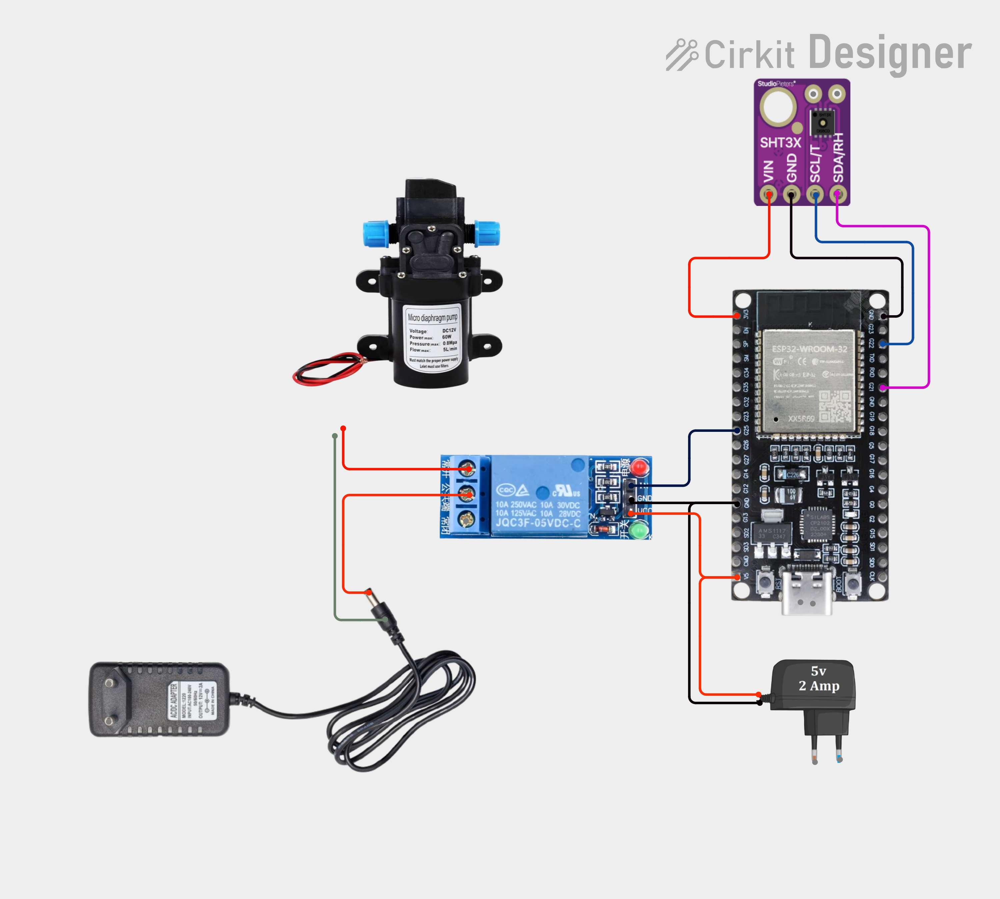

---

## 1. Hardware Connections

Wire your components to the ESP32 development board as follows:

| Component | Component Pin | ESP32 GPIO | Notes |
| :--- | :--- | :--- | :--- |
| **SHT31 Sensor** | **VCC** | **3.3V** | Power from 3.3V pin |
| | **GND** | **GND** | Common ground |
| | **SDA** | **GPIO 21** | I2C Data (4.7 kΩ pull-up recommended) |
| | **SCL** | **GPIO 22** | I2C Clock (4.7 kΩ pull-up recommended) |
| **Relay Module** | **Channel 1 IN** | **GPIO 25** | Unified Relay / Dedicated Temp Relay |
| | **Channel 2 IN** | **GPIO 26** | Dedicated Humidity Relay (Individual Mode) |
| | **VCC / GND** | **5V / GND** | External 5V supply recommended for coils |
| **Reset Key** | **BOOT Button** | **GPIO 0** | Onboard button (hold 5 seconds to factory reset) |

---

## 2. Compilation & Flashing

### Option A: Arduino IDE
1. Install **ESP32 by Espressif Systems** via **Board Manager** (`Tools > Board > Boards Manager`).
2. Install **Adafruit SHT31 Library** via **Library Manager** (`Sketch > Include Library > Manage Libraries...`).
3. Open `esp32_sht31_controller.ino`.
4. Select **Tools > Board > ESP32 Dev Module**.
5. Click **Upload**.

### Option B: Download and Flash the Firmware 
- Download the `esp32-sht31-0x0.bin` above and flash the firmware to offset `0x0`

---

## 3. First-Time Connection & Access

1. **Power on the ESP32.**
2. On your phone, tablet, or laptop, scan for Wi-Fi networks and connect to:
   - **SSID:** `ESP32_SHT31`
   - **Password:** `12345678`
3. **Captive Portal:** The web management interface will pop up automatically. If it does not, open any browser and navigate to:
   ```
   http://192.168.4.1/
   ```

---

## 4. Operational Controls & Settings

- **Dashboard Tab:** Displays live temperature (°C/°F toggle), relative humidity, calculated dew point, apparent heat index, min/max statistics, SHT31 onboard heater switch, and real-time relay status.
- **Sensor & Relays Tab:**
  - **Unified Relay Mode (GPIO 25):** Controls a single unified load using `OR`, `AND`, `Temp Only`, or `Hum Only` logic.
  - **Individual Relays Mode:** GPIO 25 controls Temperature; GPIO 26 controls Humidity.
  - **Thresholds & Direction:** Configure High/Low limits for cooling/heating or dehumidification/humidification.
  - **Electrical Polarity:** Select *Active Low* for standard relay boards or *Active High* for solid-state/transistors.
  - **Anti-Chatter Delay:** Sets minimum hold time between relay switches (1–300 seconds) to prevent rapid contact toggling.
- **WiFi AP Settings Tab:** Change network SSID, WPA2 password (min. 8 characters), Wi-Fi channel, and visibility.
- **Diagnostics Tab:** Real-time 64-bit uptime, RAM heap metrics, sensor inquiry telemetry, and NVS flash write wear counter.

---

## 5. Factory Reset

To restore default factory settings at any time:
- **Hardware Method:** Press and hold the onboard **GPIO 0 (BOOT)** button continuously for **5 seconds**. The system will clear NVS storage, turn off relays, and reboot to factory defaults.
- **Software Method:** Open the **Diagnostics** tab in the web UI and click **Restore Factory Defaults**.
